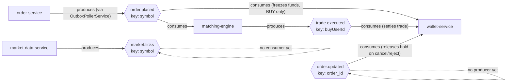

# Current-State Kafka Topic Flow

3 of the 5 topics in `CLAUDE.md`'s Kafka Topics table have live traffic today;
a 4th (`order.updated`) has a real consumer but no producer yet.

## Status vs. target state

| Topic | Producer | Consumer(s) today | Status |
|---|---|---|---|
| `market.ticks` | market-data-service | *(none)* | Produced, unconsumed. risk-service (target) doesn't exist yet. |
| `order.placed` | order-service (outbox) | matching-engine, wallet-service | **Fully wired and verified** (Step 15/16/17) |
| `trade.executed` | matching-engine | wallet-service | **Fully wired and verified** (Step 17) |
| `order.updated` | *(not implemented)* | wallet-service | Consumer built and contract-verified (Step 17), but **no producer exists** — matching-engine and order-service both still need to emit this |
| `notification.events` | *(not implemented)* | — | notification-service doesn't exist yet |

## Verified delivery-semantics behavior (not just designed — actually tested)

- **order.placed survives a Kafka outage**: Step 15's journal documents
  stopping the `trading_kafka` container, placing an order, confirming the
  DB commit still succeeds, restarting Kafka, and confirming the outbox
  poller catches up within one poll cycle.
- **matching-engine does NOT yet dedup on `orderId`** — a replayed
  `order.placed` (the real possibility the above resilience creates) would be
  matched twice today. Documented as a known gap in Step 16's journal, not
  silently ignored.
- **wallet-service IS idempotent on `trade.executed`**: the same trade
  message published twice was verified this session to settle exactly once
  (ledger entries and balances unchanged on replay, confirmed via the DB
  unique index on `(reference_id, wallet_id, entry_type)`).
- **wallet-service's `order.updated` listener was verified by hand-publishing
  test messages directly to the topic**, not through a real producer — there
  isn't one yet. This is the same verification technique used for
  matching-engine in Step 16, applied here because the upstream producer
  genuinely doesn't exist, not as a shortcut around building one.
